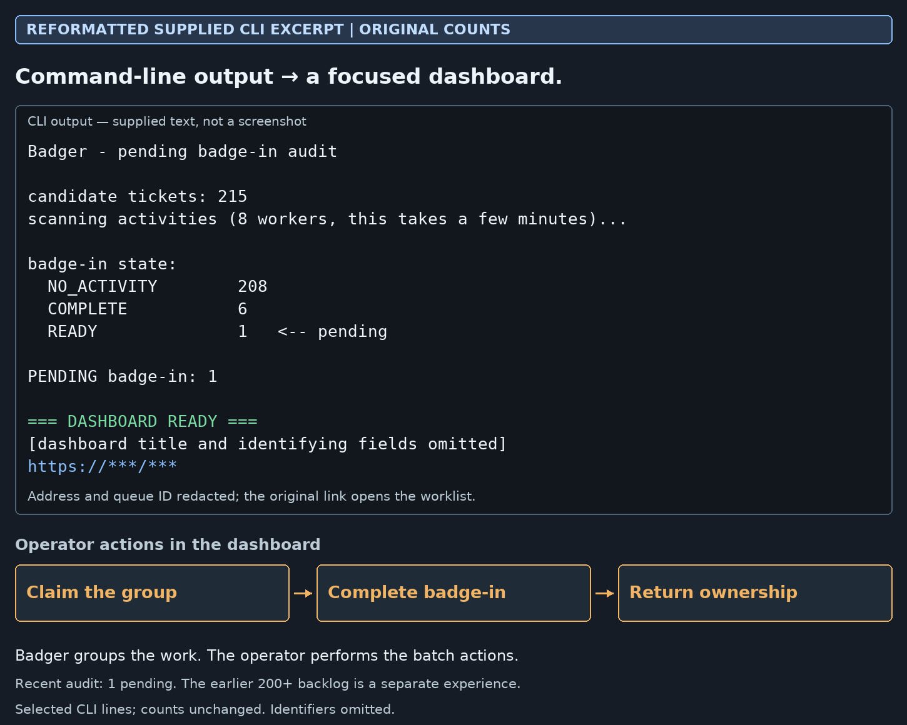
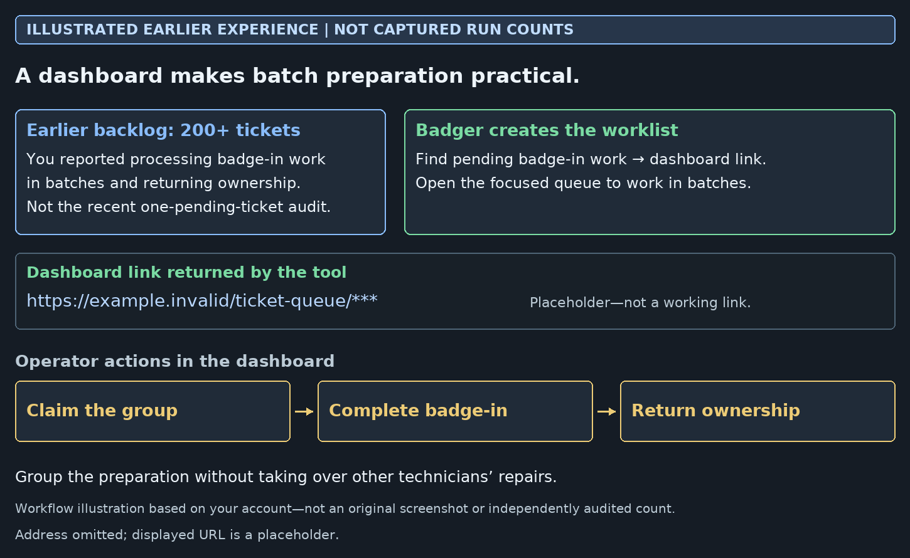

# Batch work organizer

[Back to portfolio](../README.md)

The tool finds pending preparation work and returns a focused dashboard link. The operator then claims, processes and returns ownership in batches. Grouping should help technicians, not take over their repairs.

## CLI output → dashboard

**Reformatted supplied text, not a screenshot:** the recent audit reported 215 candidates and one pending case. Counts are unchanged; the URL is redacted. Orange boxes show operator actions, not actions performed automatically by the script.

## Why I built it

**Earlier experience, not captured audit statistics:** I reported handling a 200+ ticket backlog. That is separate from the small recent audit. The displayed URL is an illustrative placeholder.

I adjusted the workflow after grouped tickets left in my name disrupted other technicians’ work. Returning ownership became part of the process. AI assisted implementation and testing.
