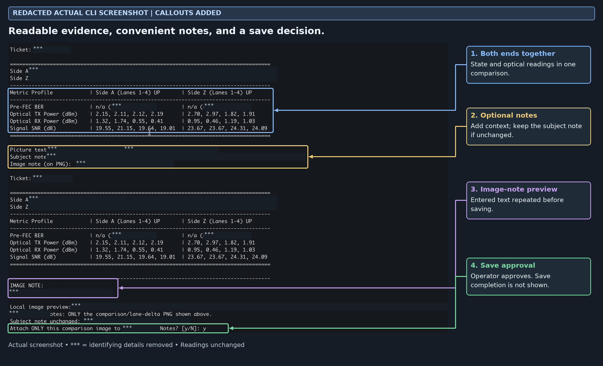
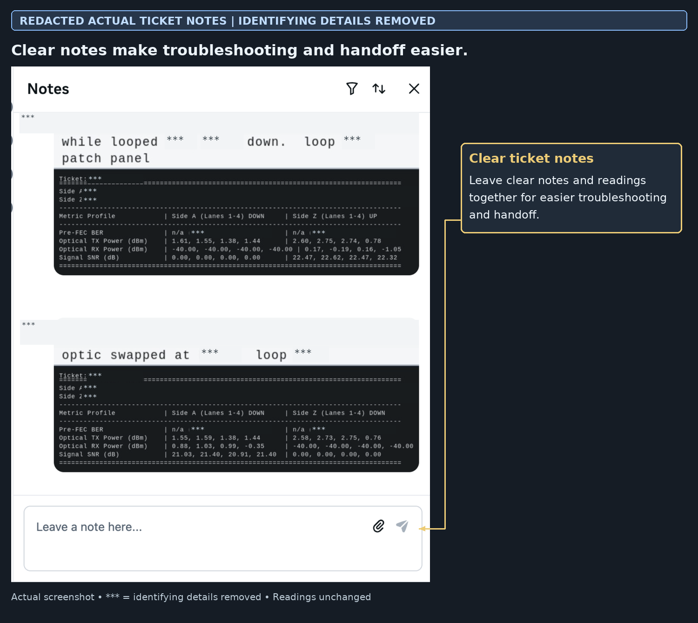

# Circuit evidence viewer

[Back to portfolio](../README.md)

I use the tool before a repair for a quick overview, during troubleshooting to compare each end independently, and afterward to check status and readings. Readable notes make follow-up easier for the next technician.

## CLI comparison and note prompts

**Actual screenshot, identifying fields removed:** both-end readings, optional notes and approval before attachment. Save completion is not visible in this capture.

## Where ticket notes are left

**Actual Notes screenshot, identifying fields removed:** context and readings stay together instead of being buried in long raw output. The annotation is inside the image, separate from the Subject note field.

Each end’s status is reported separately. Loopback UP/DOWN states are troubleshooting evidence, not proof that the normal end-to-end circuit is healthy.

I refined the readings, component identification, comparisons, layout and note prompts as needs arose. AI assisted implementation and testing. Improved readability and handoff are my observations; service-level gains remain unmeasured.
