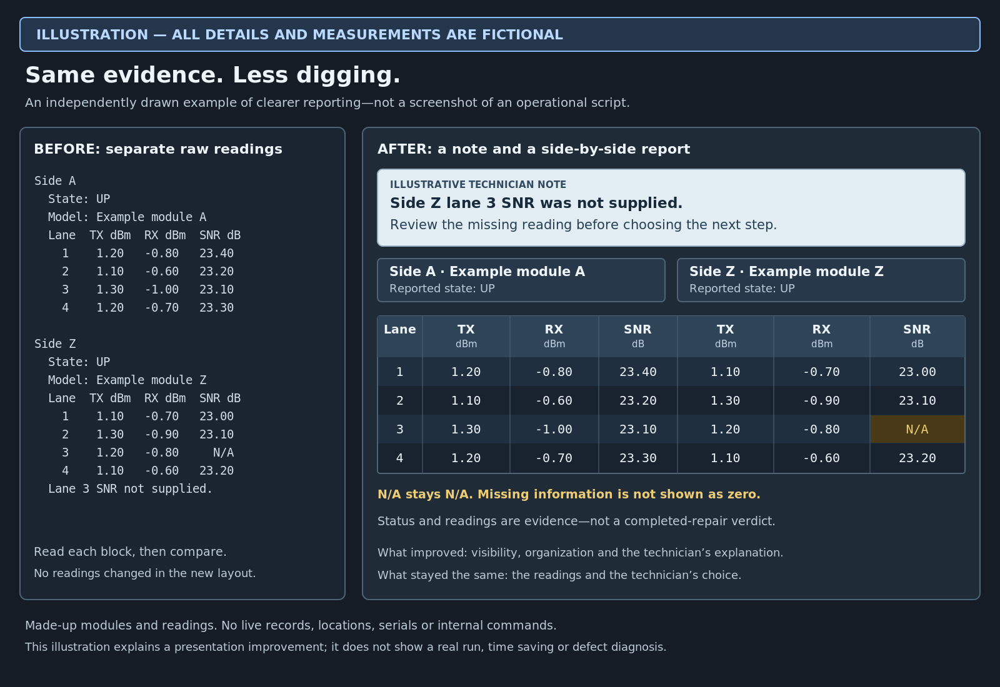

# Circuit evidence viewer

[Back to portfolio](../README.md)

## The problem

Long device-stat outputs can make a difficult repair harder to understand. Important measurements and earlier notes are easy to miss when they are buried in raw text.

## What the tool helps with

It displays supported measurements from both ends of a circuit alongside component information. It turns that evidence into a compact comparison, with an optional technician annotation above it. The annotation is part of the image, not a separately editable comment.

The comparison helps people investigate and explain readings. It does not choose their troubleshooting method or declare a component defective just because its model appears in the report.

## Made-up illustration — not live measurements

**All module labels and measurements in this illustration are made up.** It was drawn independently to explain the presentation improvement; it is not a screenshot produced by the operational tool.

The same readings appear on both sides of the illustration. The clearer layout puts the two circuit ends together and places the technician's explanation above them. Side Z lane 3 SNR remains **N/A**, highlighted as missing information rather than replaced with zero. Reported UP status and readable values are evidence, not a completed-repair verdict.

The point is easier reading and handoff—not changing the data, choosing a troubleshooting step, proving a defective component or claiming measured time savings.

## My contribution

I refined the measurements shown, comparison presentation, highlights, component identification and note prompts as I encountered new needs. AI helped implement and test those changes. This is an example of improving a tool through use rather than accepting its first version.

## What changed

I found the output easier to read and hand off than large raw captures. Faster attention to difficult or overdue repairs is a potential benefit, not a measured service-level result. The specific component investigation and internal device-reading methods are omitted from this copy.
