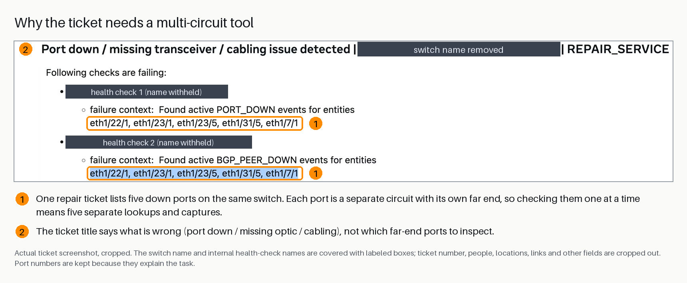
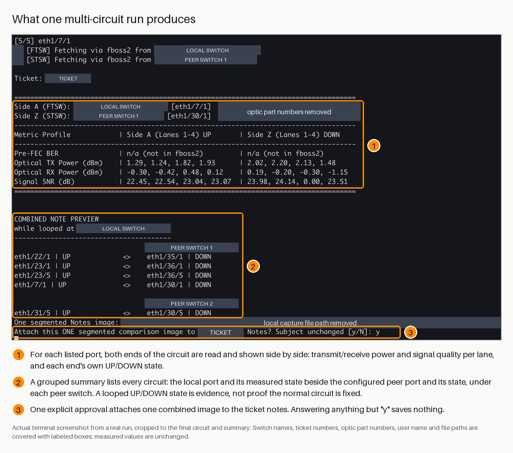
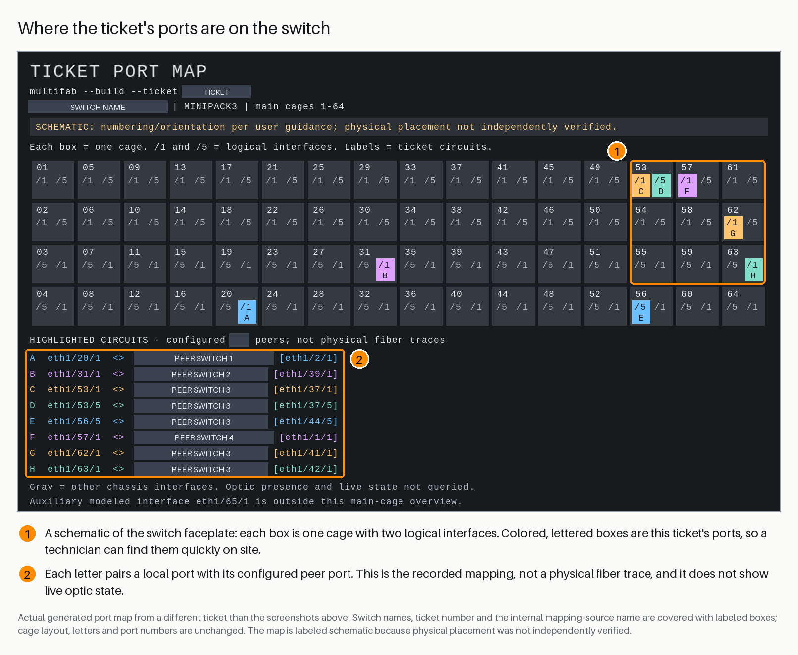

# Multi-circuit evidence collection

[Back to portfolio](../README.md)

A single repair ticket can list several down ports on one switch. Each port is its own circuit with a far end on another switch. I developed this workflow so a technician can check all of a ticket's circuits in one pass, see both ends of each, and leave one readable record. It builds on the [circuit evidence viewer](circuit-evidence-viewer.md) and is a separate workflow, not an automatic repair pipeline.

## The problem in the ticket



The ticket says what is wrong and which local ports are affected. It does not say where the other end of each circuit is. Done one at a time, that is a lookup and a capture per port.

## Workflow and data flow

```text
Ticket: list of affected local ports
      |
Recorded mapping -> peer switch and port for each
      |
Read both ends of each circuit (sequentially, time-stamped)
      |
Per-circuit comparison + grouped summary
      |
Technician reviews -> one approval -> one combined image in the ticket notes
```

The technician does any physical work, such as looping or reseating, separately. The tool does not change device state, and it does not decide whether the normal end-to-end circuit is healthy.

## What a run produces



Each end's UP/DOWN state is reported independently. Missing or unreadable data stays marked as unverified rather than being treated as healthy. A looped UP/DOWN result is troubleshooting evidence, not proof the circuit is fixed.

## Finding the ports on the switch



A companion map mode draws the switch's cage layout and highlights the ticket's ports, each lettered and paired with its recorded peer. It is labeled schematic because physical placement was not independently verified, and it does not query optic presence or live state.

## My contribution

I identified the need, specified the summary layout and handoff, tested changes during real use, and refined them through feedback. Examples include removing unnecessary technician prompts, keeping each end's measured state separate, grouping peers under one heading each, adding the port map, and requiring one explicit save confirmation. AI assisted with implementation and offline testing. Time savings have not been measured.

## Scope of this page

The screenshots are real, cropped, with switch names, ticket numbers, optic part numbers, internal check and system names, user names and file paths covered by labeled boxes. Measured values, port numbers and layout are unchanged. The port map comes from a different ticket than the other two screenshots. This repository contains descriptions and reviewed screenshots only, not the internal script, installer, credentials or a connection to workplace systems.
