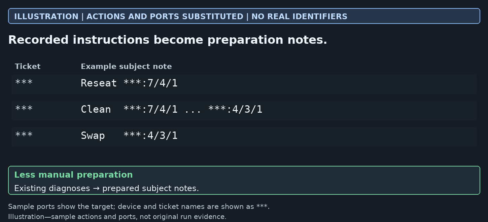
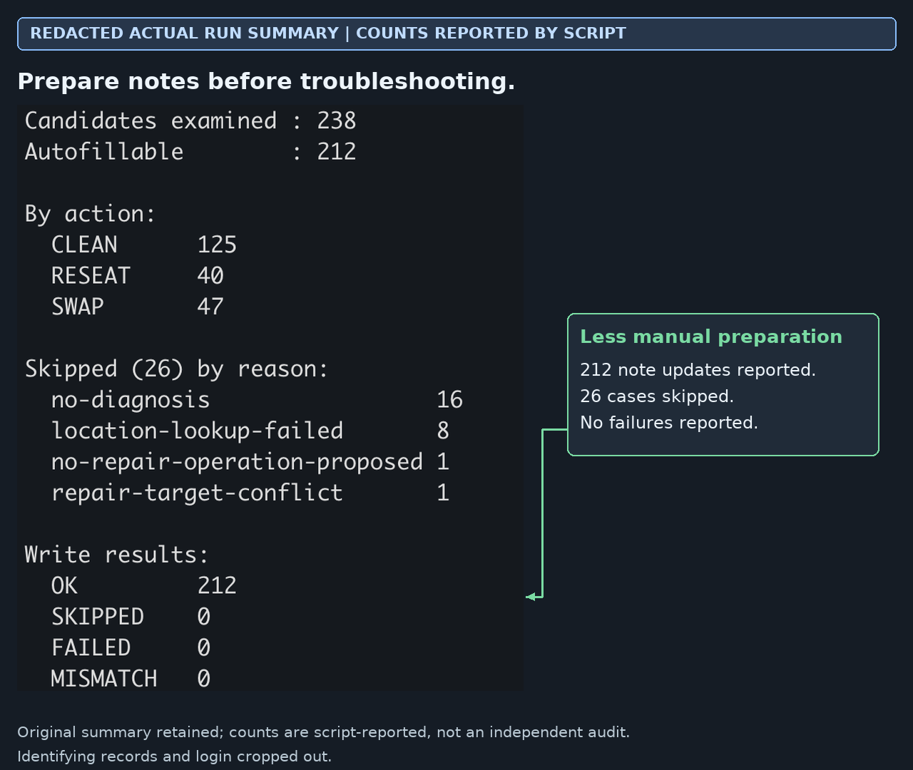

# Note preparation

[Back to portfolio](../README.md)

The tool prepares blank subject notes from existing diagnoses. It saves repetitive preparation without deciding the technician’s troubleshooting method. Existing notes and incomplete cases remain protected.

## What a prepared note looks like

**Modified illustration:** actions and ports are substituted, not unchanged run evidence.

## What the run reported

**Actual screenshot, identifying rows cropped out:** 212 updates and 26 excluded cases reported by the script. This is not an independent audit or a measurement of hours saved.

I shaped the scope and note format, reviewed use and refined the tool with feedback. AI assisted implementation and testing.
